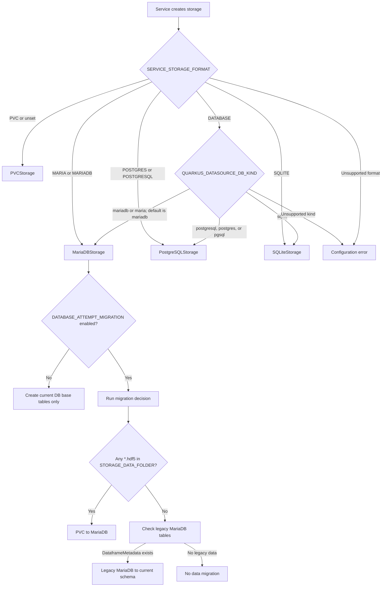
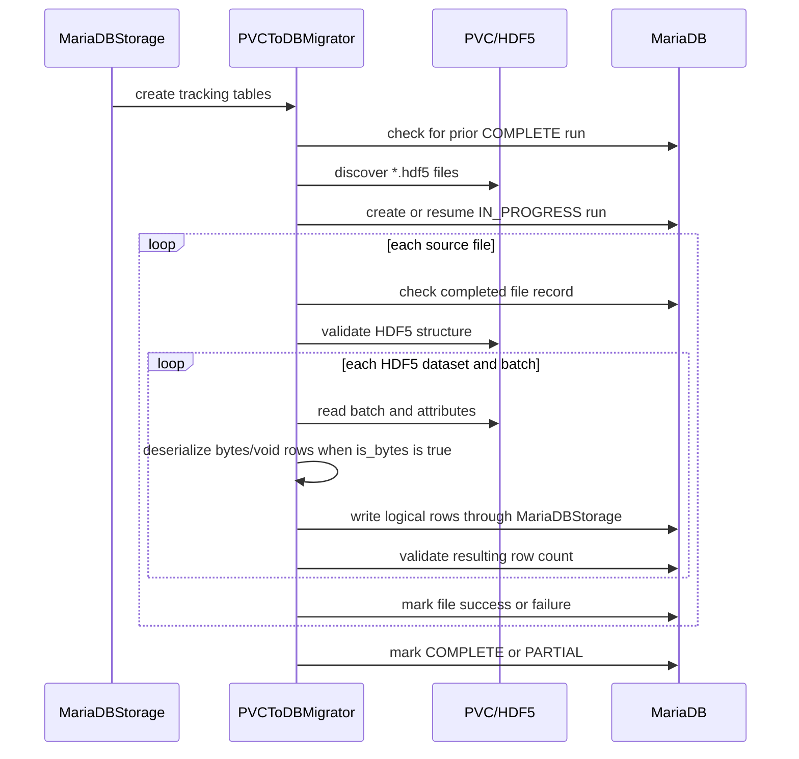

# Storage migration tutorial: PVC, CSV, and databases

> **EXPERIMENTAL MIGRATION FEATURE — NOT PRODUCTION-READY**
>
> Every migration path described here is completely experimental at this stage.
> Do not use it for production cutovers or against the only copy of important
> data. Test using disposable source copies and targets, keep a verified and
> restorable source backup, and independently validate migrated data before
> cutover or removing source storage. Behavior and interfaces may change without
> notice.

This tutorial describes the storage migration behavior implemented by the
Python TrustyAI service in this repository. It is an implementation guide for
service developers and operators. It is not a description of an external
operator contract.

## 1. The short version

The service has two automatic migration paths when MariaDB storage is selected
and migration is enabled:

1. **PVC to MariaDB:** reads HDF5 files from the configured PVC mount and
   writes their logical datasets into the MariaDB `trustyai_v2_*` schema.
2. **Legacy MariaDB to the current schema:** reads the older Java-serialized
   MariaDB tables and writes input, output, and metadata datasets through the
   current `MariaDBStorage` implementation.

The PVC path has priority. If at least one `*.hdf5` file is found in
`STORAGE_DATA_FOLDER`, the service runs the PVC migration and returns without
checking the legacy database tables in that startup. The legacy path is
considered only when no HDF5 file is found.

There is no implemented MariaDB-to-PVC rollback migration and there is no
versioned database schema-upgrade framework. Backend initialization creates
the current tables as needed; that schema setup is separate from copying stored
inference data. The two automatic data migrations are startup paths.

Separately, the explicit `trustyai-migrate` command provides a cross-database
data-transfer suite with durable migration tracking. It reads CSV files and
their metadata sidecars alongside the existing Python HDF5 PVC and MariaDB
sources, and can target SQLite, MariaDB, or PostgreSQL. This is a
command-driven migration, not an automatic startup path.

### Migration routes at a glance

| Source | Destination | How it runs |
| --- | --- | --- |
| Python HDF5 PVC | MariaDB | Startup or `trustyai-migrate` |
| Legacy MariaDB | Current MariaDB | Startup; CLI needs position keys |
| HDF5/CSV PVC or v2 MariaDB | SQLite, MariaDB, PostgreSQL | CLI only |

Startup migration requires `DATABASE_ATTEMPT_MIGRATION`; HDF5 takes priority
over legacy MariaDB. The CLI accepts `pvc`, `pvc-csv`, and MariaDB `legacy` or
`trustyai_v2` sources.

The CSV source is not detected by the service's automatic startup migration.
Use `trustyai-migrate --source pvc-csv` for that layout.

## 1.1 Explicit CSV-on-PVC migration suite

The CSV PVC layout differs from this repository's HDF5 layout. For each model
ID, it stores a record CSV and two sidecar files in the configured folder:

| File | Contents |
| --- | --- |
| `<model>-<data-file>` | Headerless combined input/output rows |
| `<model>-internal_data.csv` | Headerless `tag,id,timestamp` rows |
| `<model>-metadata.json` | Schemas, aliases, tensor names, and counts |

The data filename defaults to `data.csv`.

Run the standalone migration command with the `migration` extra. For example,
to move the Java PVC to PostgreSQL:

```bash
uv run --extra migration trustyai-migrate \
  --source pvc-csv \
  --source-path /inputs \
  --data-file data.csv \
  --target-url "$TRUSTYAI_MIGRATION_TARGET_URL" \
  --namespace java-pvc-cutover \
  --quiesced
```

Use a `mariadb+asyncmy://...` target URL for MariaDB or
`postgresql+asyncpg://...` for PostgreSQL, or `sqlite+aiosqlite:///...` for a
local SQLite target. The command requires `--quiesced` for every source and
uses bounded batches, migration tracking, source checksums, collision checks,
and post-write verification. It does not remove or modify the PVC. Keep the
source until the run reports `COMPLETE` and the destination has been checked.

The source adapter requires all three files for every discovered model. It
validates the data and internal CSV row counts against each other and against
`observations` in the JSON sidecar; reads `inputSchema.items` and
`outputSchema.items` in their declared column-index order; and preserves the
original names, aliases, Java data types, tensor names, and recorded-inference
flag. The internal timestamp string is retained exactly, including fractional
nanoseconds. Java `TENSOR` cells are parsed as data with `javaobj-py3` and an
allowlist of the Java Tensor class and boxed scalar/string element types; the
migration does not invoke Java `ObjectInputStream` or execute serialized Java
classes.
Set `STORAGE_DATA_FILENAME` or pass `--data-file` when the source uses a name
other than `data.csv`.

## 1.2 Cross-database migration commands

Use `trustyai-migrate` when the destination is PostgreSQL or SQLite, or when
you want an explicit, command-driven migration rather than the MariaDB startup
path. The CLI accepts `pvc`, `pvc-csv`, and `mariadb` sources. Set the target URL
securely in `TRUSTYAI_MIGRATION_TARGET_URL` or pass it with `--target-url`:

| Destination | SQLAlchemy URL driver |
| --- | --- |
| MariaDB | `mariadb+asyncmy://...` |
| PostgreSQL | `postgresql+asyncpg://...` |
| SQLite | `sqlite+aiosqlite:///...` |

Avoid putting credentials directly in shell history. For example, migrate a
Python HDF5 PVC to either MariaDB or PostgreSQL by setting the target URL to the
corresponding driver above, then running:

```bash
uv run --extra migration trustyai-migrate \
  --source pvc \
  --source-path /inputs \
  --target-url "$TRUSTYAI_MIGRATION_TARGET_URL" \
  --namespace pvc-cutover \
  --quiesced
```

The HDF5 CLI source defaults to `trustyai.hdf5`; pass `--data-file` if the
mounted PVC uses another suffix. To migrate MariaDB data to PostgreSQL, set
`TRUSTYAI_MIGRATION_SOURCE_URL` to the MariaDB source URL and the target URL as
shown above, then run:

```bash
uv run --extra migration trustyai-migrate \
  --source mariadb \
  --source-url "$TRUSTYAI_MIGRATION_SOURCE_URL" \
  --source-schema auto \
  --target-url "$TRUSTYAI_MIGRATION_TARGET_URL" \
  --namespace maria-to-postgres \
  --quiesced
```

The MariaDB source URL uses the `mariadb+asyncmy://...` driver.
`--source-schema auto` detects the supported legacy or `trustyai_v2` MariaDB
layout when only one is present. If both layouts exist, select `legacy` or
`trustyai_v2` explicitly. For any source, append `--dry-run` to validate and
decode it before transferring. A dry run still requires a syntactically valid
target URL, but it does not connect to, initialize, or write to the target, so
it does not verify target availability.

**Legacy CLI compatibility is deliberately restricted.** The legacy source
requires `DataframeMetadata_names.names_ORDER` and
`DataframeMetadata_inputs.inputs_ORDER`. For each model, both must identify
exactly the same contiguous, zero-based column positions as
`DataframeRow_Values.order_column`. The CLI rejects missing, duplicate, null,
or gapped positions before initializing or writing to the target. The original
`tests/resources/legacy_database_dump.sql` lacks these position columns and is
therefore rejected by the explicit migration suite.

Unordered SQL results cannot establish which name or input/output flag belongs
to a stored cell. Do not invent position values from insertion order, names,
or independently sorted tables. Obtain an authoritative column-position mapping
or a verified CSV export with the required metadata sidecars. The older startup
legacy converter is unchanged; it must not be treated as a workaround that
proves an ambiguous source safe. Current-schema MariaDB migration is unaffected.

The required `--quiesced` flag is an operator confirmation, not a lock: the
command does not stop writers or provide a distributed lock. By default, the
post-write checksum can detect source changes between preflight and
verification, but it cannot prevent inconsistent reads during the transfer.
Quiesce the source or use a consistent snapshot before running either dry-run
or transfer. For a new migration with no matching run in the selected tracking
namespace, the target canonical dataset layout must be empty; the CLI rejects
unrelated existing target datasets. `--namespace` scopes migration-tracking
tables only; it does not isolate the destination datasets.

Transfers are batched, but checkpoints are not saved after each batch. After an
interrupted, `PARTIAL`, or `FAILED` run, a retry can clear and rewrite datasets
from row zero, including datasets that completed during the earlier attempt.
It does not continue from the last successful batch. Keep the same source
snapshot and target, and allow enough time and capacity for a full replay.

A completed migration is audit-only on every subsequent invocation, including
with `--no-resume`. If the destination has changed, the command fails without
clearing data or changing the completed checkpoint. Never replay an old source
over a live destination. Use a separate empty target for a deliberate new copy.

`--no-resume` is retained for compatibility; it does not change these replay or
audit rules. `--no-checksums` skips the final source re-hash, not the full
row-by-row and metadata comparison. Leave checksums enabled for cutovers.

Database and checkpoint failures return a nonzero exit code and a JSON failure
result. Never remove the source when `safe_to_remove_source` is false. During a
database outage, the durable checkpoint can remain `IN_PROGRESS` because the
command cannot update an unavailable database. Preserve the command's JSON and
stderr output, restore connectivity, and retry against the same snapshot.

The command rejects unselected CSV/HDF5 storage files rather than silently
migrating only one historical filename generation. Use a complete, isolated
snapshot with consistent filenames. CSV fields are capped at 16,777,216 characters;
larger cells fail validation. The parser restores the process CSV limit after
each parsing pass.

SQLite transfers require a persistent file path; in-memory targets are accepted
only for dry runs. Close the migration process and open the destination through
the service before deciding that a cutover is safe. SQL backends read the imported
column types, tensor names, and recorded-inference flag from the canonical
registry. A subsequent current-schema MariaDB migration preserves those fields.

CSV transfer and verification retain a text seek cursor per dataset for linear
sequential reads, including quoted multiline fields. Random reads may restart
from the beginning. Migration namespaces create only run and dataset-state
tables; service data is stored solely in the canonical `trustyai_v2_*` layout.

The CLI follows the service's TLS policy: an explicitly configured CA must be
usable, even if `DATABASE_ALLOW_INSECURE_TLS=true`. If insecure TLS is prohibited,
a missing default CA also causes an error. These network settings do not apply
to local SQLite targets.

## 2. Storage layouts and terminology

### PVC storage

`PVCStorage` stores one HDF5 file per logical dataset by default. The file name
is derived from the dataset name and the configured PVC data-file suffix. A
dataset normally represents one of the following model streams:

| Logical dataset | Meaning |
| --- | --- |
| `<model>_inputs` | Input features or request data |
| `<model>_outputs` | Model outputs or predictions |
| `<model>_metadata` | Row-level metadata such as timestamps and tags |

The HDF5 dataset carries attributes such as `column_names` and `is_bytes`.
Non-numeric rows are serialized in the PVC implementation and are deserialized
by the migration before they are written to MariaDB.

### Current MariaDB storage

The MariaDB backend uses a generated table for each logical dataset:

- `trustyai_v2_table_reference`: maps datasets to generated table indexes
  and stores JSON metadata, aliases, shape, and row count.
- `trustyai_v2_dataset_<index>`: stores serialized values for one logical
  dataset.
- `trustyai_v2_partial_payloads`: stores partial payloads while inference
  inputs and outputs are reconciled.

Dataset values are written as JSON plus gzip-compressed `LONGBLOB` values. The
migration is therefore a logical data conversion, not a file copy.

The PVC migration also creates these tracking tables:

- `trustyai_migration_status`: one row per PVC migration run, including status,
  file counts, and any error message.
- `trustyai_file_migration_status`: per-file completion and failure records
  used for resumption.

## 3. How startup chooses a migration

The storage factory in `src/trustyai_service/service/data/storage/__init__.py`
selects the backend from `SERVICE_STORAGE_FORMAT`:



`MARIA` and `MARIADB` select MariaDB directly. `DATABASE` resolves
`QUARKUS_DATASOURCE_DB_KIND` (default: `mariadb`) and can select MariaDB,
PostgreSQL, or SQLite. Only the MariaDB backend runs the automatic startup
migration decision controlled by `DATABASE_ATTEMPT_MIGRATION`; selecting a
backend by itself does not migrate data.

`MariaDBStorage` always creates the current reference and partial-payload
tables during initialization. The migration flag controls whether it then
starts the data migration. If an event loop is already running, migration is
scheduled as an asynchronous task. Otherwise initialization runs it with
`asyncio.run`.

## 4. Configuration for a PVC-to-MariaDB migration

The following is a representative configuration. Do not put real credentials
in a shell history, manifest, or document.

```text
SERVICE_STORAGE_FORMAT=MARIA
DATABASE_ATTEMPT_MIGRATION=true
STORAGE_DATA_FOLDER=/inputs
MIGRATION_BATCH_SIZE=10000

DATABASE_HOST=<mariadb-host>
DATABASE_PORT=3306
DATABASE_USERNAME=<username>
DATABASE_PASSWORD=<password>
DATABASE_DATABASE=<database>
```

The migration flag accepts `1`, `true`, `yes`, and `on`, case-insensitively.
`MIGRATION_BATCH_SIZE` defaults to `10000` and must be positive. Each database
batch write has a five-minute timeout in the current implementation.

The service also accepts the operator-oriented aliases below when the direct
names are absent:

| Direct setting | Fallback setting |
| --- | --- |
| `DATABASE_USERNAME` | `QUARKUS_DATASOURCE_USERNAME` |
| `DATABASE_PASSWORD` | `QUARKUS_DATASOURCE_PASSWORD` |
| `DATABASE_HOST` | `DATABASE_SERVICE` |
| `DATABASE_DATABASE` | `DATABASE_NAME` |

If `DATABASE_TLS_CA_CERT` is set and the file exists, the MariaDB connection
uses it for certificate verification. The default path checked by the service
is `/etc/tls/db/ca.crt`.

`STORAGE_DATA_FOLDER` is the important source setting for migration. The
migrator scans that directory for every file matching `*.hdf5`; it does not use
`STORAGE_DATA_FILENAME` to select a single source file. When the setting is
omitted on the MariaDB path, the migration code uses `/inputs`.

## 5. Recommended migration procedure

### Step 1: Prepare the source and target

Before starting the migration:

- Keep the PVC mounted and readable at `STORAGE_DATA_FOLDER`.
- Make a recoverable backup of the PVC and the destination database.
- Confirm that the image includes the MariaDB extra. For a local environment,
  use `uv sync --all-groups --extra mariadb`; the container build uses the
  extras declared in `requirements.txt`, including `migration`. The standalone
  command requires `uv sync --all-groups --extra migration` locally.
- Ensure the destination database, credentials, and TLS settings are valid.
- Quiesce inference writes if possible. The migration reads the PVC while the
  service can otherwise continue receiving data, and the implementation does
  not establish a distributed migration lock.
- Run one migration-capable service instance while the migration is active.

Do not remove or detach the PVC at this stage.

### Step 2: Start MariaDB mode with migration enabled

Start the service with `SERVICE_STORAGE_FORMAT=MARIA` or
`SERVICE_STORAGE_FORMAT=DATABASE`, `DATABASE_ATTEMPT_MIGRATION=true`, and the
database settings. The process creates the current base tables, detects the
HDF5 files, and starts `PVCToDBMigrator`.

### Step 3: Confirm discovery and tracking

The migration creates its tracking tables and records an `IN_PROGRESS` run.
The service logs the number of HDF5 files discovered. The run records:

- `total_files`: number of HDF5 files discovered for that run;
- `files_processed`: successful files plus files skipped as already complete;
- `error_message`: run-level or partial-failure information.

Each file receives a corresponding row in
`trustyai_file_migration_status` when it succeeds or fails.

### Step 4: Validate the result before removing the PVC

Use the database and service logs to verify the migration. The following SQL
is illustrative; use the exact database connection and permissions for the
deployment:

```sql
SELECT id, migration_type, status, started_at, completed_at,
       files_processed, total_files, error_message
FROM trustyai_migration_status
WHERE migration_type = 'PVC_TO_DB'
ORDER BY started_at DESC
LIMIT 1;

SELECT migration_id, file_name, dataset_name, rows_migrated,
       completed_at, error_message
FROM trustyai_file_migration_status
WHERE migration_id = <migration-id>
ORDER BY file_name;

SELECT dataset_name, n_rows, metadata
FROM trustyai_v2_table_reference
ORDER BY dataset_name;
```

For each source file, verify the expected logical datasets and row counts in
`trustyai_v2_table_reference`. For a representative sample, compare values and
column names with the source data. The completion log is:

```text
Migration complete, the PVC is now safe to remove.
```

Treat the log as one piece of evidence, not as the only check. Remove the PVC
only after the latest run is `COMPLETE`, every expected file is successful, and
the data checks are satisfactory.

## 6. What the PVC migration does internally

The main control flow is:



### 6.1 Source discovery and file validation

The migrator scans only the top-level configured folder for `*.hdf5` files. For
each file it checks that:

- the file contains at least one HDF5 dataset; and
- every dataset has a `column_names` attribute.

Empty datasets are accepted by the validation step and produce a warning.

### 6.2 Dataset conversion

For each HDF5 dataset, the migrator reads:

- the dataset values;
- `column_names`; and
- the `is_bytes` attribute.

When `is_bytes` is true and the HDF5 dtype is bytes or `void`, the migrator
calls `deserialize_rows`. The resulting array is passed to
`MariaDBStorage.write_data`, which creates the logical dataset on first use and
appends subsequent batches.

The MariaDB writer stores each value as JSON plus gzip-compressed bytes. It
stores original column names and initializes aliased names to those same names.
The HDF5 file itself is never modified by this path.

### 6.3 Batching and row-count validation

Large HDF5 datasets are read and written in batches. The default batch size is
`10000`; set `MIGRATION_BATCH_SIZE` to change it. A batch write is protected by
a 300-second timeout.

After a non-empty HDF5 dataset is written, the migrator queries
`trustyai_v2_table_reference.n_rows` and compares the resulting count with the
source row count. A file is marked successful only after all its datasets pass
this step.

### 6.4 Resumption and idempotence

The migrator is designed to resume after a restart:

- an existing `IN_PROGRESS` run is reused;
- a file with a completed record is skipped;
- a failed file is recorded and does not stop other files from being attempted;
- a run with any failed files is marked `PARTIAL`;
- an unexpected run-level exception is marked `FAILED`.

The original HDF5 files remain in place, so a failed or partial migration can
be investigated and retried without reconstructing the PVC data.

## 7. Migration statuses and readiness

When migration is enabled, the readiness code looks at the most recent row in
`trustyai_migration_status` for migration type `PVC_TO_DB` or `LEGACY_DB`.

| Status | Current readiness behavior | Operational meaning |
| --- | --- | --- |
| `IN_PROGRESS` | Error | Do not treat the service as migration-ready |
| `FAILED` | Error | Investigate the recorded error and logs |
| `PARTIAL` | OK, with a warning | Some files failed; retain the PVC and retry |
| `COMPLETE` | OK | Candidate for PVC removal after data verification |

This means readiness `OK` is not sufficient by itself for a `PARTIAL` run.
The PVC must remain available until the failed files have been dealt with.

There is also a special case: if the PVC folder is missing or contains no HDF5
files, the startup selector skips the PVC migrator and falls through to the
legacy-database check. If the PVC migrator is invoked directly with no files,
it also returns without creating a successful tracking run. Do not interpret
either case as proof that all PVC data has been copied.

## 8. The other automatic migration: legacy MariaDB to the current schema

The second path is implemented by
`LegacyMariaDBStorageReader` in
`src/trustyai_service/service/data/storage/maria/legacy_maria_reader.py`.
It is selected only when the PVC scan found no HDF5 files.

### Detection

The reader checks for the legacy `DataframeMetadata` table. If that table is
absent, it does nothing. If it exists, it lists legacy model IDs and processes
each model.

### Conversion

For each legacy model, the reader:

1. Reads rows from `DataframeRow` and `DataframeRow_Values`.
2. Deserializes the Java-serialized values with `javaobj`.
3. Reads the original column names and input/output classification from the
   legacy metadata tables.
4. Reads the legacy name mappings.
5. Writes three current logical datasets through `MariaDBStorage`:
   `<model>_inputs`, `<model>_outputs`, and `<model>_metadata`.
6. Applies the input and output name mappings to the new datasets.

The reader treats a model as already migrated only when all three target
datasets exist. It does not drop the legacy tables.

### Important differences from PVC migration

The legacy reader currently does not create a `LEGACY_DB` row in
`trustyai_migration_status`, does not use the per-file tracking table, and does
not provide the same per-batch progress and row-count validation. The readiness
code contains `LEGACY_DB` in its query, but the legacy reader itself does not
write that status record. Verify this migration through the target dataset
contents and logs, and retain the legacy tables until the result is confirmed.

If both HDF5 files and legacy tables exist, the HDF5 path wins for that startup.
The legacy path will not run in the same migration decision after the PVC path
returns.

## 9. Other migration-like procedures to keep in mind

### 9.1 PVC serialized-void-type compatibility procedure

This is not an automatic PVC-to-MariaDB migration. Older PVC datasets can have
a smaller NumPy `void` capacity than newly serialized rows require. The PVC
storage implementation documents the compatibility procedure:

```python
data = await storage.read_data(dataset_name)
await storage.delete_dataset(dataset_name)
await storage.write_data(dataset_name, data, column_names)
```

The recreated dataset uses the current maximum serialized capacity. Take a
backup first and preserve the original data until the rewrite has been
validated. A PVC-to-MariaDB migration normally deserializes byte rows before
writing them to MariaDB, but malformed or unreadable source rows can still
fail migration.

### 9.2 Current-schema initialization

Creating `trustyai_v2_table_reference` and
`trustyai_v2_partial_payloads`, or lazily creating a
`trustyai_v2_dataset_<index>` table for a new dataset, is schema initialization,
not a data migration. It happens when MariaDB storage is initialized or when a
new dataset is first written.

### 9.3 Configuration aliases are not migrations

`SERVICE_STORAGE_FORMAT=DATABASE` selects the backend from
`QUARKUS_DATASOURCE_DB_KIND` (default: `mariadb`). The operator and
direct-deployment database environment-variable aliases are also only
configuration compatibility. They do not copy or transform data.

## 10. Current limitations worth making explicit

These points describe the current code and should be considered before using
the migration as an operational handoff:

- **A completed PVC run short-circuits future PVC processing.** Once any
  `PVC_TO_DB` run is marked `COMPLETE`, the PVC migrator returns before
  rediscovering and processing source files. New files added under the same
  PVC are therefore not imported by this path.
- **Completion is keyed by file name.** A previously completed basename is
  skipped on later runs, even if its contents have changed. The tracking schema
  does not record a source checksum or modification version.
- **There is no distributed migration lock.** Multiple migration-capable pods
  should not be started against the same source and target at the same time.
- **Empty HDF5 datasets are not written.** The code logs that an empty dataset
  will migrate as metadata-only, then skips its write. Verify whether an empty
  logical dataset is required by the deployment.
- **The row-count validator is called with a zero pre-migration count.** Its
  helper supports a delta comparison, but the current file migration call does
  not pass an existing row count. Existing target data therefore needs explicit
  verification, especially after an interrupted write.
- **Legacy migration has weaker observability.** It is not represented in the
  same migration tracking tables, and the readiness query can report that
  migration status is unavailable even though the legacy reader ran.
- **The explicit CLI rejects unordered legacy metadata.** Its position-key
  requirement is described in Section 1.2. Historical dumps without those keys
  are not supported by this command, even if the older startup reader accepts
  them. The command never guesses column roles from physical row order.
- **There is no reverse migration.** Switching from MariaDB back to PVC does
  not copy the current database contents to HDF5.

## 11. Tests and source map

The migration-focused tests are:

```bash
# PVC migration unit tests; no live MariaDB data set is required
uv run pytest tests/service/data/storage/maria/test_pvc_migration.py -v

# Legacy MariaDB migration integration test; requires the MariaDB test service
uv run pytest tests/service/data/test_mariadb_migration.py -v

# Readiness and storage-selection behavior
uv run pytest tests/service/test_health_checks.py \
  tests/service/data/test_storage_factory.py -v

# Cross-database migration tests, including CSV PVC sources
uv run --extra migration pytest tests/service/data/migrations/ -v -n 0
```

The legacy integration test expects a MariaDB instance seeded from
`tests/resources/legacy_database_dump.sql`. The local MariaDB service
definition is `tests/resources/compose-local-maria.yaml`.

In the explicit migration suite, that original unordered dump instead exercises
safe rejection before target writes. Ordered legacy-contract transfer tests use
an isolated SQLite fixture with explicit, deliberately shuffled position keys;
they do not claim support for the unordered historical MariaDB layout. The
required live MariaDB-to-PostgreSQL path uses the current v2 schema, including
a CSV-to-MariaDB-to-PostgreSQL tensor-only round trip.

The main implementation locations are:

- `src/trustyai_service/service/data/storage/__init__.py`: selects PVC or
  MariaDB and parses migration configuration.
- `src/trustyai_service/service/data/storage/maria/maria.py`: initializes the
  current schema and selects PVC versus legacy migration.
- `src/trustyai_service/service/data/storage/maria/pvc_migration.py`: implements
  PVC discovery, transfer, tracking, and validation.
- `src/trustyai_service/service/data/storage/maria/legacy_maria_reader.py`:
  reads and converts legacy Java-serialized MariaDB data.
- `src/trustyai_service/service/data/migrations/pvc_csv.py`: reads CSV data
  with its model/internal metadata sidecars.
- `src/trustyai_service/service/data/migrations/runner.py`: runs batched
  migrations with durable tracking and verifies target results.
- `src/trustyai_service/service/data/migrations/target.py`: writes the shared
  canonical SQL layout for SQLite, MariaDB, and PostgreSQL.
- `src/trustyai_service/service/health_checks.py`: reports storage and
  migration readiness.
- `tests/service/data/storage/maria/test_pvc_migration.py`: exercises PVC
  migration tracking and transfer behavior.
- `tests/service/data/migrations/test_pvc_csv_source.py`: exercises CSV source
  parsing and SQL-target transfers.
- `tests/service/data/test_mariadb_migration.py`: exercises legacy MariaDB
  migration with seeded data.
